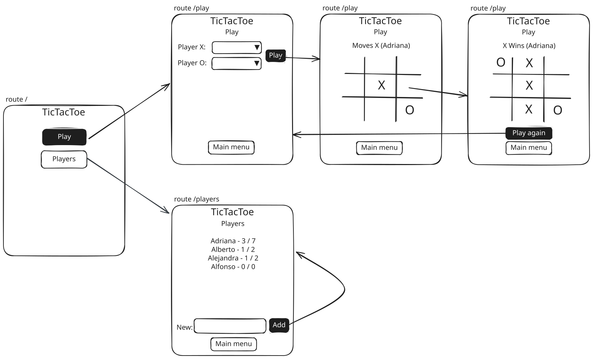

# Simulacro segunda prueba 2026sem2

Simulacro de segunda prueba del curso de Desarrollo Web y Mobile.

## Inicialización

Crear un _fork_ privado de este repositorio. Clonar el _fork_ y completar el ejercicio en la carpeta `web`. Entregar mediante un _pull request_ al repo _forkeado_, dentro de los plazos establecidos.

Durante la prueba se podrá usar todo material presente en la computadora, pero no se podrá conectar a Internet, ni usar asistentes de IA.

Para instalar las dependencias ejecutar en la raíz del repositorio clonado el comando:

```> npm i```

El servidor de desarrollo provisto por Vite sirve tanto la interfaz como la API. Para iniciar ejecutar el comando:

```> npm start```

Esto levanta el servidor de desarrollo en [localhost:5173](http://localhost:5173/), por ej. [localhost:5173/play](http://localhost:5173/play). La API se sirve bajo [localhost:5173/api](http://localhost:5173/api), por ej. [localhost:5173/api/players](http://localhost:5173/api/players).

Se debe trabajar en la carpeta `/src`. Por favor no modificar otros archivos, y de ser necesario confirmarlo con los docentes.

## TicTacToe en React

El ejercicio se trata de implementar una aplicación _web_ para jugar al Tatetí. Un croquis de interfaz de usuario pueden verse en la carpeta `/specs/design.svg`.



El estado inicial del código **no** implementa este diseño como se muestra. El trabajo del estudiante cambiar el código dado para que encaje con este diseño.

Se deben tener tres rutas.

### Ruta 1: `/`

Página de inicio o _home_. Muestra un título y dos botones para navegar hacia las otras dos rutas.

### Ruta 2: `/play`

Página de juego. Inicialmente se muestran dos selectores (_dropdowns_) para elegir un jugador para las _X_ y un jugador para las _O_. También se muestra un botón de _Play_ para iniciar la partida,

Iniciada la partida se muestra el tablero de juego. Ambos jugadores juegan en la misma interfaz. La aplicación muestra a quién le toca en cada momento.

Al finalizar la partida se indica quién ganó, y se muestra un botón para volver a jugar.

En todo momento se muestra un botón para volver al inicio.

### Ruta 3: `/players`

Página de jugadores. Se muestra un listado de los jugadores registrados, con nombre, y las cantidades de partidos ganados y de partidos jugados.

Debajo de la lista se muestra una entrada y un botón para agregar nuevos jugadores. Más abajo se muestra un botón para volver al inicio.

## Tareas

+ _Modificar estilos, textos y cualquier otro detalle para encajar la implementación en el diseño_. El código inicial implementa algunas funcionalidades, pero no de acuerdo con el diseño dado.

+ _Implementar la página de inicio_. El código inicial redirige de `/` a `/play`.

+ _Implementar la página de `/players`_. El código inicial no tiene nada de esta ruta implementado.

## API

+ `GET /api/players` retorna los jugadores registrados en la base de datos. Ver _hook_ `useFetchPlayers`.

Un ejemplo de jugador es:

```json
{ "id": "1",
  "name": "Adriana"
}
```

+ `GET /api/players/:id` retorna el jugadores con el `id` dado.

+ `GET /api/players/:id/matches` retorna los partidos en los que participó el jugador con el `id` dado. 

+ `PUT /api/players` agrega un usuario nuevo. Solo debe darse el nombre (`name`), ya que la API calcula el `id` automáticamente. Ver _hook_ `useCreatePlayer`.

+ `GET /api/matches` obtiene todos los partidos en la base de datos. Ver _hook_ `useFetchMatches`.

Un ejemplo de partido es:

```json
{ "id": "1",
  "playerX": "1",
  "playerO": "3",
  "history": [
    ".........",
    "X........",
    "X...O....",
    "X.X.O....",
    "XOX.O....",
    "XOX.OX...",
    "XOX.OXO..",
    "XOX.OXO.X"
  ],
  "winner": "X"
},
```

+ `PUT /api/matches` agrega un partido nuevo. Ver _hook_ `useCreateMatch`.

_Fin_